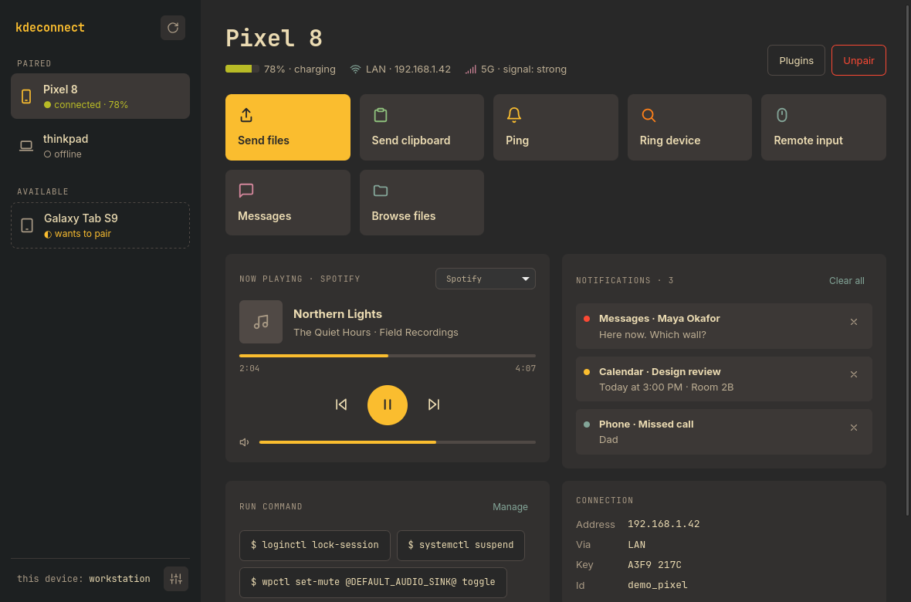
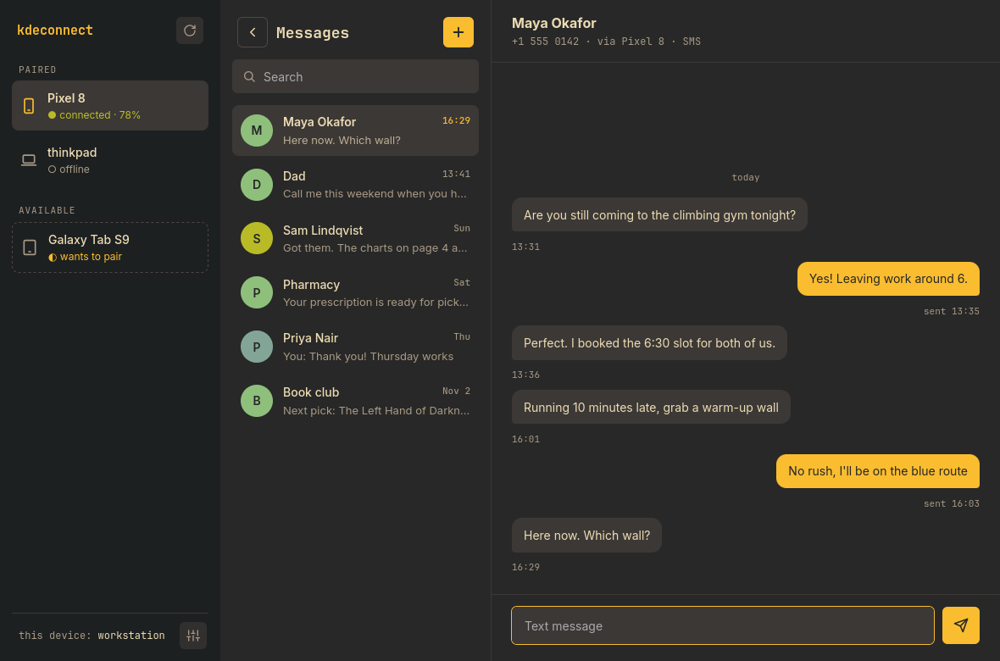
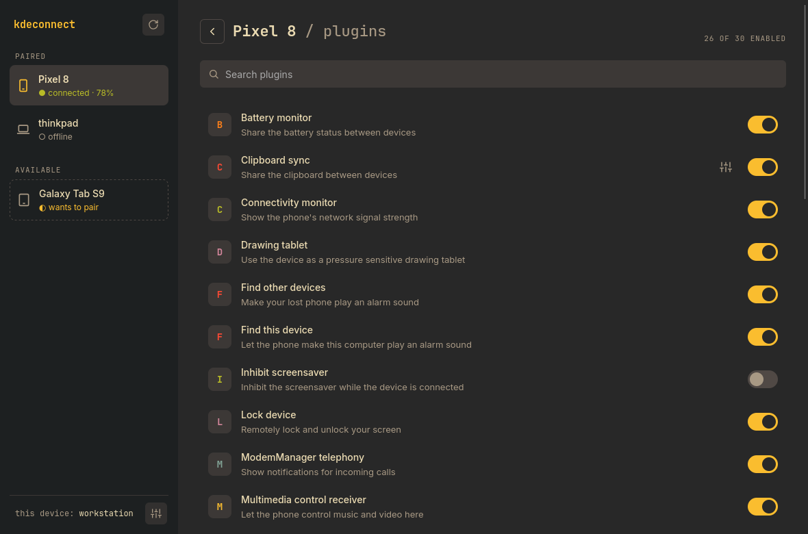
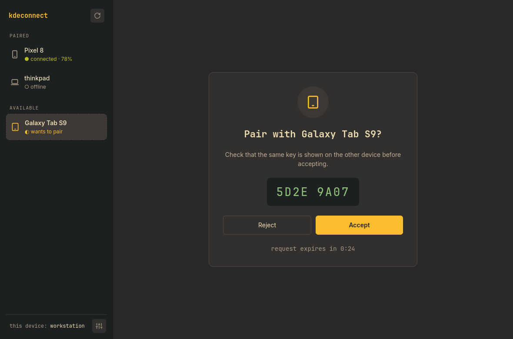
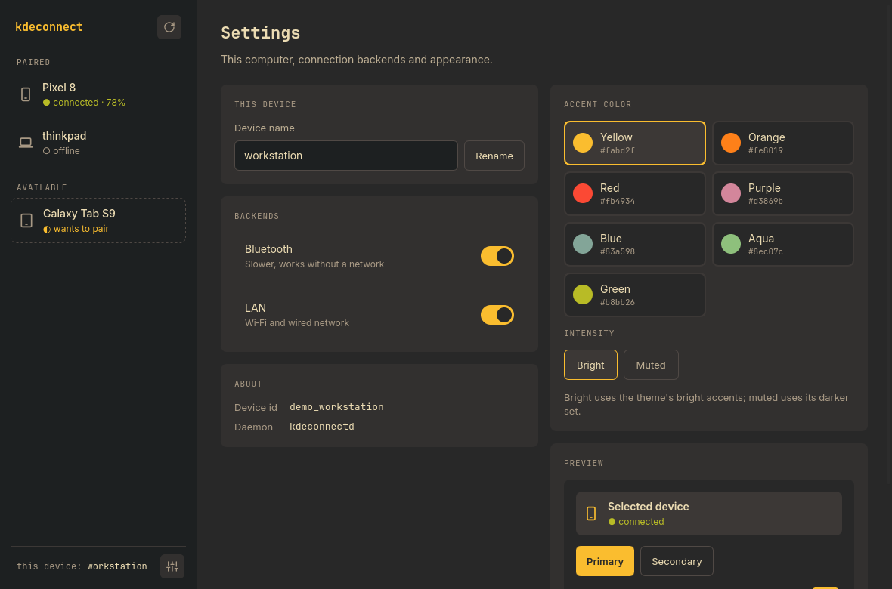
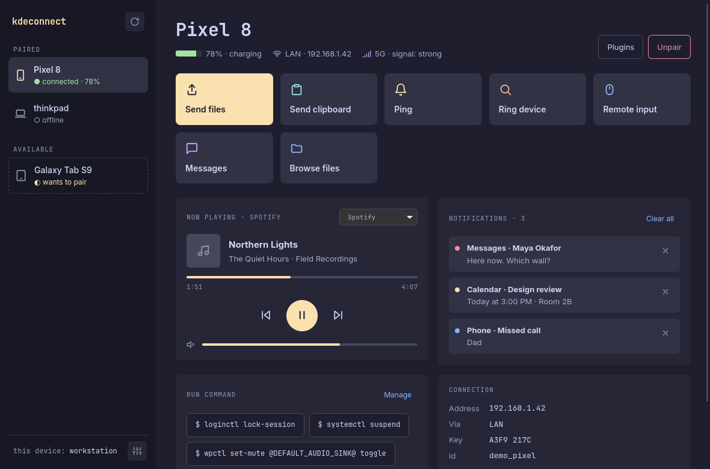

# kdeconnect-skin

A themeable window for [KDE Connect](https://kdeconnect.kde.org/), for desktops
where the stock Qt app looks out of place (Hyprland, sway, river, …).

It is only a window. Pairing, plugins and the connection to your phone all stay
in the stock `kdeconnectd`, which this talks to over D-Bus, so it works with
whatever phone app version upstream supports, and you can switch back to
`kdeconnect-app` at any time.



| | |
|---|---|
|  |  |
|  |  |
|  | |

The screenshots use demo mode (below), so every device, contact and message in
them is made up.

## What it does

- **Devices**: paired and available devices; pair, accept or reject requests
  with the verification key; unpair.
- **Overview**: battery, signal and address; send files, send clipboard, ping,
  ring, browse the phone's files (SFTP); media controls for the phone's player;
  the phone's notifications, with dismiss.
- **Messages**: SMS conversations, search, replies and new conversations.
- **Remote input**: a touchpad for the phone's pointer.
- **Plugins**: turn each plugin on or off; settings for Share (download
  folder), Clipboard, Pause media during calls, Send notifications, and the
  commands the phone may run on this computer.
- **Settings**: this computer's name, LAN / Bluetooth backends, accent colour.
- `kdeconnect-skin --share FILE|URL ...` opens a small "send to device" window.

## Install

### Nix

```nix
# flake input
inputs.kdeconnect-skin.url = "github:mukheshpugal/kdeconnect-skin";

# then, e.g. in home-manager
home.packages = [ inputs.kdeconnect-skin.packages.${pkgs.system}.default ];
```

`packages.<system>.catppuccin-mocha` is the same with the other bundled theme.
For anything else, override the package:

```nix
kdeconnect-skin.override { theme = ./my-theme.css; }
# or straight from a Nix palette with the names below
kdeconnect-skin.override { colors = import ./palettes/gruvbox-dark.nix; }
```

`overlays.default` adds `pkgs.kdeconnect-skin`.

### Other distributions

Needs the KDE Connect daemon (`kdeconnect` / `kdeconnect-kde`), Python 3,
PyGObject, GTK 4 and WebKitGTK 6.0. For example:

| Distribution | Packages |
|---|---|
| Arch | `kdeconnect python-gobject gtk4 webkitgtk-6.0` |
| Fedora | `kdeconnectd python3-gobject gtk4 webkitgtk6.0` |
| Debian / Ubuntu | `kdeconnect python3-gi gir1.2-gtk-4.0 gir1.2-webkit-6.0` |

```sh
make install                                   # ~/.local, gruvbox-dark
make install THEME=catppuccin-mocha PREFIX=/usr/local
make uninstall
```

The body font is Inter and the monospace face JetBrains Mono (Nerd Font
first); install them for the intended look, otherwise the system defaults are
used. The Nix package bundles Inter.

## Themes

A theme is a CSS file that sets these variables on `:root`. The names follow
Gruvbox's, but any palette maps onto them; see
[`themes/catppuccin-mocha.css`](themes/catppuccin-mocha.css).

| Variables | Used for |
|---|---|
| `bg0_hard` | sidebar and window background |
| `bg0` | main pane |
| `bg0_soft` | cards |
| `bg1`, `bg2`, `bg3` | raised surfaces, borders, inactive controls |
| `fg0`, `fg1` | text (`fg0` also as text on dark accents) |
| `fg2`, `fg3`, `fg4` | secondary text, labels |
| `bright_{red,green,yellow,blue,purple,aqua,orange}` | accents, status colours |
| `dark_{red,green,yellow,blue,purple,aqua,orange}` | the "muted" accent set |

The accent itself is picked in the app's Settings and saved in
`~/.config/kdeconnect-skin/settings.json`.

## Development

```sh
make run      # installs into ./build and starts it with KDECONNECT_SKIN_DEBUG=1
nix build     # the Nix package
```

`src/kdeconnect_skin.py` is the GTK window and the D-Bus bridge; `src/web/` is
the page. The page sends `{id, method, args}` to the Python side; the Python
side pushes a full state snapshot back whenever a daemon signal says something
changed. With `KDECONNECT_SKIN_DEBUG=1` the WebKit inspector is enabled and the
page's console goes to stdout.

`KDECONNECT_SKIN_DEMO=1 kdeconnect-skin` runs against made-up devices,
messages and notifications (`src/demo.py`) instead of the daemon, without
touching the session bus. Use it for screenshots and for working on the page
without a phone. Point `XDG_CONFIG_HOME` and `XDG_STATE_HOME` at a scratch
directory too, so the accent you pick and any message you "send" stay out of
your real config.

Plugin names and settings keys come from KDE Connect 26.04.

## License

MIT, see [LICENSE](LICENSE).
